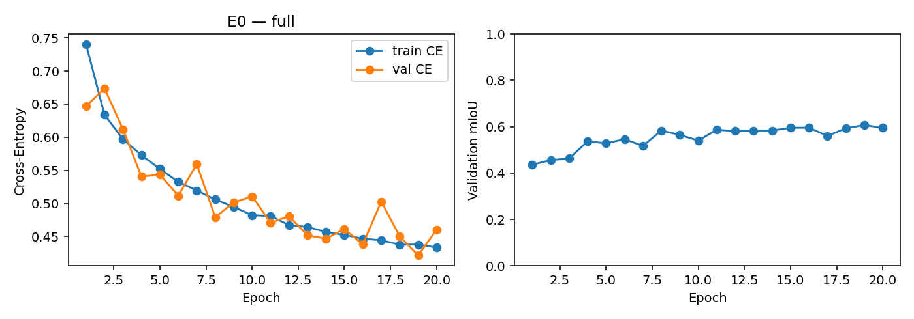
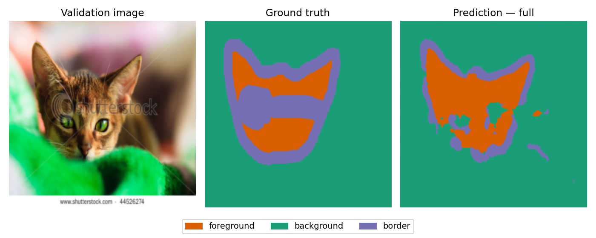

# E0: Small FCN with Cross-Entropy

This run trained the Small FCN for 20 epochs on Colab using a Tesla T4.
The best validation mIoU was reached at epoch 19. The checkpoint was selected
using validation mIoU; the test set was not evaluated in this run.

| Validation metric at epoch 19 | Value |
|---|---:|
| mIoU | 60.76% |
| Foreground IoU | 66.30% |
| Background IoU | 81.22% |
| Border IoU | 34.77% |
| Cross-Entropy loss | 0.421692 |

The final epoch had a validation mIoU of 59.52%, so `best.pt` contains the
epoch 19 weights. The prediction below uses that checkpoint.

The run used 2,937 training and 736 validation images from
`configs/train_val_split_clean.csv`, with seven invalid masks excluded.
Settings: 256 x 256 inputs, batch size 8, Adam with learning rate 0.001,
20 epochs, seed 42, and random horizontal flips for training.
The model has 287,843 trainable parameters.

Training used commit `99cb249cd4dfc44243e9454d1a8716cebb95f6a9` with no
tracked changes, Python 3.13.16, PyTorch 2.11.0+cu130, and Torchvision
0.26.0+cu130. Full configuration, environment details, and source/split
hashes are in [run.json](run.json). Per-epoch losses, IoUs, and confusion
matrices are in [history.json](history.json).





The model captures the main pet region, but this example still has holes
and boundary errors. Border is also the lowest-scoring class across the
validation set.

`best.pt` is stored locally in this folder and is ignored by Git. Its SHA-256 is:

```text
c54b625c4a0eccb93e8eb16cb8d7c78301c5b0dd1a2ba8a54804281c86caaf22
```
